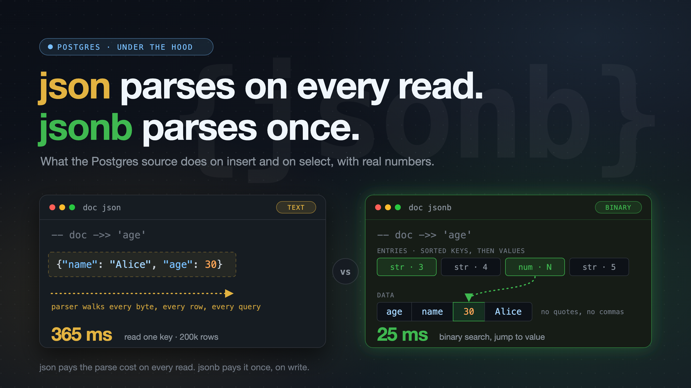

We have been using `JSON` & `JSONB` columns in Postgres in prod for years now.
These 2 data types are used to store JSON in Postgres.

I faintly knew that `JSONB` is efficient n all but did not know "why"/enough details until today.

So I went through the Postgres source code with help of [DeepWiki](https://deepwiki.com/postgres/postgres), and then tested what I learned on Postgres 18.

TLDR: 

**`json` parses your document on every read. `jsonb` parses it once, on write.**



We will go through the details in the rest of the post:

### json is just text

When you insert into a `json` column, Postgres does two things:

1. It runs the JSON parser over the input, only to check that it is valid.
2. It stores your input exactly as you sent it, as text.

That is all. In the source, the input function for `json` ends with this comment:

```c
/* Internal representation is the same as text */
PG_RETURN_TEXT_P(result);
```

Because it is text, Postgres keeps everything: whitespace, key order and duplicate keys.

```sql
postgres=> SELECT '{"name": "Alice",   "age": 30, "id": 7, "name": "Bob"}'::json;
                          json
--------------------------------------------------------
 {"name": "Alice",   "age": 30, "id": 7, "name": "Bob"}
(1 row)
```

Both `name` keys are stored. When you read it, `->> 'name'` returns the last one, `Bob`.

### jsonb is a parsed tree

JSONB came after JSON. The "b" stands for binary, though many people jokingly say it means better.

When you insert into a `jsonb` column, Postgres runs the same parser. But this time it also builds a tree from your document, and then writes that tree to disk in a binary format.

This is sometimes called a "decomposed binary format". In simple words: Postgres takes the document apart and files each piece away with a small label.

For `{"name": "Alice", "age": 30}`, the stored object looks roughly like this:

```text
header:   object, 2 pairs

entries:  [string, 3 bytes]    <- key 1
          [string, 4 bytes]    <- key 2
          [numeric, N bytes]   <- value of key 1
          [string, 5 bytes]    <- value of key 2

data:     agename<30 as numeric>Alice
```

The entries do not hold your keys or values. Each entry is a 4-byte label with only two things in it:

- the **type** of the item (string, numeric, bool, null, or a nested object/array)
- the **length** of its bytes in the data part (every 32nd entry stores an offset instead, more on that below)

The actual bytes are stored only once, one after the other, in the data part. (`true`, `false` and `null` need no bytes there. The type in the entry says it all.) There are no quotes, commas or separators. Postgres adds up the lengths to find where each item starts.

All keys come first, in sorted order, then all values in the same order. So key 1 goes with value 1, and so on.

While building this tree, Postgres also does the following:

- It **sorts the keys**. The order is by key length first, then byte by byte. That is why `id` comes before `age`.
- It sorts keys at **every level**, not only the top level. Each nested object is sorted on its own when the parser reaches its closing `}`. This is required: Postgres uses binary search on nested objects too, and binary search only works on sorted keys.
- It **removes duplicate keys**, also at every level. The last value wins.
- It **removes whitespace**.
- It **converts numbers** to Postgres `numeric`.

```sql
SELECT '{"name": "Alice",   "age": 30, "id": 7, "name": "Bob"}'::jsonb;

{"id": 7, "age": 30, "name": "Bob"}
```

**Why length first?** Binary search needs a fixed order. It does not need alphabetical order. Each entry already stores the key length. So Postgres compares two numbers first. It compares the key text only when the lengths are equal. This makes each step of the search cheap.

Nested objects are sorted and deduplicated the same way:

```sql
SELECT '{"user": {"name": "Alice", "age": 30, "age": 31}, "id": 7}'::jsonb;

{"id": 7, "user": {"age": 31, "name": "Alice"}}
```

Numbers are stored as `numeric`, so the exponent form is lost, but trailing zeros are kept:

```sql
SELECT '{"reading": 1.230e-5}'::json  AS j,
       '{"reading": 1.230e-5}'::jsonb AS jb;

           j           |           jb
-----------------------+-------------------------
 {"reading": 1.230e-5} | {"reading": 0.00001230}
```

All this work is why a `jsonb` insert costs more than a `json` insert.

### Reading one key

This is where the two types are really different.

**With `json`**, `doc ->> 'name'` gives the raw text to the JSON parser again. The parser walks the document and watches for the key you asked for. It does this for every row, on every query.

I expected it to be fast when the key is the first one in the document. It was not. The parser still goes through the whole document. In my benchmark below, reading the first key and the last key took the same time.

**With `jsonb`**, there is no parsing. The keys are already sorted, so Postgres does a **binary search** on the key entries. When it finds the key, the matching value entry tells it where the data is. It reads only that value.

```text
json:   doc ->> 'name'
        text --> parse whole document --> find "name" --> return

jsonb:  doc ->> 'name'
        binary search on sorted keys --> jump to value --> return
```

A few more details I found interesting:

- **Arrays**: `doc -> 5` goes straight to the 6th entry. There is no search at all.
- **Small objects**: I asked if binary search is worth it for 10 keys. Postgres does not care. It always uses binary search. For 10 keys that is about 4 string compares, so the gain from a linear scan would be very small.
- **Offsets vs lengths**: each entry stores either the end offset of its data or only its length. Postgres stores an offset in every 32nd entry and lengths in the rest. Offsets make lookups fast. Lengths compress much better when a large value is compressed (TOAST). This mix gives both. To find an item, Postgres reads at most 32 entries back.

### The numbers

I ran a small test on my Mac with Postgres 18.6. I made 200,000 rows. Each row had a document with 50 string keys, about 1.4 KB. I put the same data in a `json` table and a `jsonb` table. Each number is the median of three runs.

| Operation (200k rows)            | `json`   | `jsonb`  |
| -------------------------------- | -------: | -------: |
| Insert                           | 1,013 ms | 1,968 ms |
| Read one key (`doc ->> 'key_1'`)  |   365 ms |    25 ms |
| Read one key (`doc ->> 'key_50'`) |   369 ms |    29 ms |
| Read the whole document as text  |    22 ms |   326 ms |

What this shows:

- **Insert**: `jsonb` took about 2x longer. That is the cost of building the tree.
- **Read one key**: `jsonb` was about 13 to 15x faster. `json` took the same time for the first and the last key, because it parses the whole document both times.
- **Read the whole document**: `json` was about 15x faster. This one surprised me at first. `json` already is text, so Postgres sends it as is. For `jsonb`, Postgres must turn the binary data back into text for every row. Note that this measures work inside the server only. When an app fetches the rows, both types also pay for sending them over the network, so the gap you see will be smaller.

One thing to keep in mind: at 1.4 KB, these documents are small enough to stay inside the row, uncompressed. That is the best case for `jsonb` key reads. With bigger documents, both types must first load and decompress the value (see [What jsonb does not fix](#what-jsonb-does-not-fix)), so the gap gets smaller.

On disk, both tables were about the same size for this data. For small documents, `jsonb` can be bigger, because each item has a 4-byte entry. A 3-key document was 41 bytes as `json` and 65 bytes as `jsonb`.

This is not a full benchmark. It is one machine and one shape of data. But it shows where each type pays its cost.

### What else jsonb gives you

Because `jsonb` is a known structure, Postgres can do more with it:

- **Indexes**: you can create a GIN index on a `jsonb` column. It makes `@>`, `?`, `?|`, `?&` and jsonpath queries fast. For `json`, you can only index an expression, like `(doc ->> 'email')`.
- **Equality**: two `jsonb` values with the same content are equal, even if the input had different whitespace or key order. `json` has no equality operator at all. Try `SELECT DISTINCT` on a `json` column:

  ```text
  ERROR:  could not identify an equality operator for type json
  ```

  The same goes for `GROUP BY` and `UNION`.
- **More operators and functions**: containment (`@>`), key exists (`?`), `jsonb_set`, `jsonb_path_query` and more. Most of these do not exist for `json`.

### What jsonb does not fix

Two things are true for both types:

- **A large document is read as a whole.** If the document is big, Postgres compresses it and may store it outside the row (TOAST). To read even one key, Postgres first loads and decompresses the full value. `jsonb` makes the lookup fast after that, not the load.
- **An update rewrites the whole document.** `jsonb_set` changes one key, but Postgres still writes a new copy of the full value. Large documents that change often are expensive in both types.

### When to use json

I use `jsonb` by default. I would pick `json` when:

- **I need the exact input back.** For example, a webhook payload whose signature I must check later. A signature is over the exact bytes. `jsonb` changes key order, whitespace and number format, so the signature check would fail.
- **I need duplicate keys or key order.** `jsonb` drops duplicates and sorts keys.
- **I only write and read whole documents.** For example, a log or audit table where the app always reads the full document and never queries inside it. Then `json` is cheaper on both insert and read.

If you query inside the document, filter on it, index it, or compare it, use `jsonb`. You pay the parsing cost once, instead of on every read.

### References

- Postgres docs: [JSON Types](https://www.postgresql.org/docs/current/datatype-json.html)
- Postgres docs: [jsonb indexing](https://www.postgresql.org/docs/current/datatype-json.html#JSON-INDEXING)
- [`json.c`](https://github.com/postgres/postgres/blob/master/src/backend/utils/adt/json.c): `json_in`, which validates and stores text
- [`jsonb.c`](https://github.com/postgres/postgres/blob/master/src/backend/utils/adt/jsonb.c): `jsonb_from_cstring`, which builds the tree
- [`jsonb.h`](https://github.com/postgres/postgres/blob/master/src/include/utils/jsonb.h): the on-disk format, with very good comments on `JEntry` and `JB_OFFSET_STRIDE`
- [`jsonb_util.c`](https://github.com/postgres/postgres/blob/master/src/backend/utils/adt/jsonb_util.c): `getKeyJsonValueFromContainer`, the binary search
- [`jsonfuncs.c`](https://github.com/postgres/postgres/blob/master/src/backend/utils/adt/jsonfuncs.c): `get_worker`, where `json` is parsed again on every read
- [`jsonb_gin.c`](https://github.com/postgres/postgres/blob/master/src/backend/utils/adt/jsonb_gin.c): the GIN index support

Until next time.
